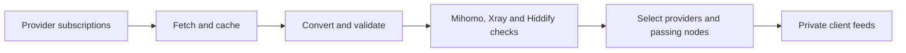

# Subscription Parser

[](https://github.com/phungvanquy/subscription-parser/actions/workflows/ci.yml)

A self-hosted dashboard for combining proxy subscriptions, checking server
connectivity, and publishing private feeds for Hiddify, Mihomo, Xray, and V2Board.

Add providers once, keep their authorized device IDs fixed, and create named
subscriptions for different devices or groups. Each subscription can include one
or more providers and has its own stable import links.

## Features

- **Multiple providers and subscriptions.** Manage up to 200 providers and any
  number of named output subscriptions, with independent provider selections.
- **Persistent server customization.** Select working servers per subscription
  and override their address, port, or name. Saved edits survive missing servers;
  changed endpoints need their own passing checks.
- **Protocol-aware conversion.** Import JSON, YAML, and plain or base64 share
  links. Preserve supported protocols, credentials, and transport settings.
- **Automatic connection checks.** Test through Mihomo, Xray and Hiddify, then publish
  only compatible nodes with recent passing results.
- **Fixed device identities.** Store authorized HWIDs in the data volume and
  explicitly assign them to providers.
- **Protected administration.** Admin-key login, optional authenticator-app 2FA,
  one-use recovery codes, revocable sessions, and persistent login rate limits.
- **Docker deployment.** A persistent data volume, separate development
  environment, and bounded debug logs.

## Quick start

Requires a Linux `amd64` or `arm64` host, Docker Engine, and Docker Compose
**2.24.4 or later**. Run these commands from a new checkout:

```sh
git clone https://github.com/phungvanquy/subscription-parser.git
cd subscription-parser
cp .env.example .env
chmod 600 .env
openssl rand -hex 32
```

Copy the generated value into `PARSER_ADMIN_TOKEN` in `.env`. For a local trial,
keep the default loopback binding and leave `PARSER_PUBLIC_URL` empty. Then start
the application:

```sh
docker compose up -d --build --wait
```

Open `http://127.0.0.1:8099` on the Docker host and sign in with your admin key.
For access from another computer, follow the [HTTPS deployment guide](docs/deployment.md#https-and-reverse-proxies).

1. Open **Settings → Account security → Set up authenticator** and save your
   recovery codes. Two-factor protection activates after you confirm a code.
2. Choose **Add provider**, enter its HTTPS subscription URL, and select its
   authorized device or **No device ID**.
3. Choose **Test fetch**, review the result, and save the provider.
4. Open **Subscriptions**, select or create a subscription, and copy the link
   for your client. Links become usable when compatible servers pass their checks.

See the [user guide](docs/usage.md) for provider setup, device management, and
subscription selection.

## Output formats

Every named subscription exposes six URLs under `/sub/<token>/`:

| File | Intended use |
| --- | --- |
| `hiddify.json` | Native Hiddify/sing-box outbounds. |
| `mihomo.yaml` | Mihomo configuration or proxy-provider feed. |
| `xray.json` | Xray outbounds and their dependencies. |
| `v2board.json` | Recommended native feed for the updated V2Board External Subscriptions integration. |
| `v2board.txt` | Legacy URI feed for older V2Board installations and share-link clients. |
| `combined.json` | Archive of client configurations, inventory, and diagnostics. |

Conversion preserves a node's protocol; it does not turn every server into VLESS.
Compatibility depends on the target core and the node's settings. The combined
archive is for inspection and integration, rather than direct client import.
See [formats and compatibility](docs/usage.md#formats-and-compatibility).

## How it works



Provider refreshes download source subscriptions using saved device assignments.
Connection checks reuse cached configurations. Each output subscription selects
its own providers while sharing downloads and check results with other subscriptions.
Subscriptions can also save individual server selections and overrides. Provider
random sampling stays in effect; customized endpoints are published only while
both the source and the customized configuration pass their client checks.

## Documentation

| Guide | Contents |
| --- | --- |
| [Deployment](docs/deployment.md) | Docker setup, environment variables, HTTPS, Nginx Proxy Manager, and persistent storage. |
| [User guide](docs/usage.md) | Providers, HWIDs, named subscriptions, client imports, compatibility, and server checks. |
| [Security](docs/security.md) | Authenticator enrollment, recovery, sessions, rate limits, and credential storage. |
| [Operations](docs/operations.md) | Updates, backups, restore, migrations, logs, and troubleshooting. |
| [API reference](docs/api.md) | Cookie authentication, endpoints, request examples, and error handling. |
| [V2Board JSON contract](docs/v2board-json.md) | Versioned native feed, validation, expiry, and client compatibility. |
| [Development](docs/development.md) | Local development, tests, CI, project structure, and core upgrades. |

Deployment settings and the admin key belong in `.env`. Provider credentials,
HWIDs, subscriptions, and authentication state belong in the persistent Docker
volume. Back up both using the [backup procedure](docs/operations.md#backup).
